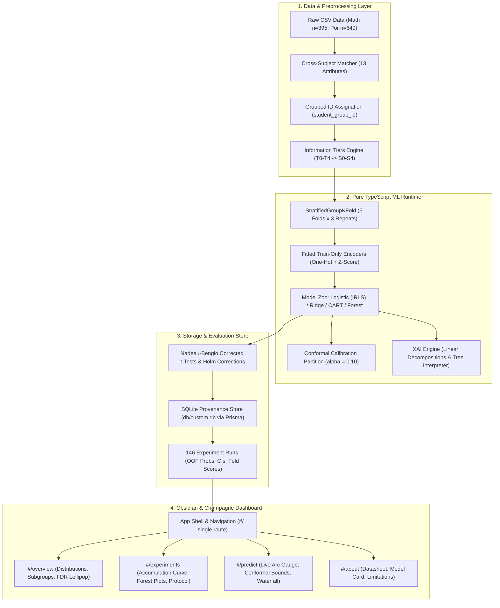

<div align="center">

```
  ███████╗██████╗ ██╗   ██╗██╗███╗   ██╗███████╗██╗ ██████╗ ██╗  ██╗████████╗    █████╗ ██╗
  ██╔════╝██╔══██╗██║   ██║██║████╗  ██║██╔════╝██║██╔════╝ ██║  ██║╚══██╔══╝   ██╔══██╗██║
  █████╗  ██║  ██║██║   ██║██║██╔██╗ ██║███████╗██║██║  ███╗███████║   ██║      ███████║██║
  ██╔══╝  ██║  ██║██║   ██║██║██║╚██╗██║╚════██║██║██║   ██║██╔══██║   ██║      ██╔══██║██║
  ███████╗██████╔╝╚██████╔╝██║██║ ╚████║███████║██║╚██████╔╝██║  ██║   ██║      ██║  ██║██║
  ╚══════╝╚═════╝  ╚═════╝ ╚═╝╚═╝  ╚═══╝╚══════╝╚═╝ ╚═════╝ ╚═╝  ╚═╝   ╚═╝      ╚═╝  ╚═╝╚═╝
```

### *Evidence, not verdicts.*
**Beyond Accuracy: A Leakage-Safe, Calibrated and Explanation-Stable Evaluation of Early Student-Risk Prediction**

---

[](tests/integrity.test.ts)
[](src/lib/ml)
[](design.md)
[-eab308?style=for-the-badge&logo=open-access&logoColor=white)](docs/preregistration.md)
[](LICENSE)

[Explore Interactive Demo](#-quick-start--reproducibility) • [Research Methodology](docs/methodology.md) • [Data Dictionary](docs/data_dictionary.md) • [Model Card](docs/model_card.md) • [Datasheet](docs/datasheet.md)

---

</div>

## 🌌 Overview & Abstract

In Educational Data Mining (EDM) and Learning Analytics, predictive models are frequently published with inflated claims of high predictive accuracy ($\ge 90\%$). Closer methodological inspection reveals systematic flaws that invalidate these benchmarks:

1. **Temporal Information Leakage:** Models mix pre-course context with late-term interim exam scores ($G_2$), declaring high accuracy when they have merely re-stated near-final grades.
2. **The Student Overlap Trap:** In multi-subject cohorts, overlapping students (such as the 366 students surveyed in both Math and Portuguese in the canonical Cortez & Silva 2008 benchmark) are split randomly, causing identical individual traits to leak across training and test partitions.
3. **Missing Simple & Trivial Baselines:** Complex gradient-boosted ensembles are hailed as breakthroughs without benchmarking against basic heuristic baselines (e.g., predicting $G_3 = G_2$, or simple failure counts).
4. **Uncalibrated & Overconfident Verdicts:** Probabilities are uncalibrated, presenting point estimates stamped *"HIGH RISK"* without distribution-free confidence intervals or decision utility metrics under intervention budget caps.
5. **Explanation Instability:** Feature importances (SHAP values) are presented as fixed causal drivers, concealing that rank orderings fluctuate wildly across seeds and cross-validation folds.

**EduInsight AI** provides a reproducible, leakage-audited, information-tiered research platform. Built with an internal **zero-dependency pure TypeScript ML engine** and wrapped in an ultra-luxurious **Obsidian & Champagne** observatory interface, it sets a higher standard for trustworthy educational data mining.

---

## 🏛️ Core Research Contributions

```
   CHRONOLOGICAL INFORMATION TIER ACCUMULATION
   ===================================================================================
   [S0 Enrolment]    T0: Demographic & family context (sex, age, Medu, Fedu...)
         │
         ▼
   [S1 History]      S0 + T1: Prior failures & institutional support (failures, schoolsup...)
         │
         ▼
   [S2 Pre-Exam]     S1 + T2: In-term habits & attendance (studytime, alcohol, absences...)
         │
         ▼
   [S3 Mid-Term]     S2 + T3: First period grade checkpoint (G1)
         │
         ▼
   [S4 Near-Oracle]  S3 + T4: Second period grade checkpoint (G2)
   ===================================================================================
   * S2-noabs: S2 excluding absences (Temporal sensitivity check)
```

- **Information-Tiered Accumulation Curve:** Demonstrates how predictive power changes as evidence accumulates ($S_0 \to S_4$), mapping where predictive jumps actually occur.
- **Grouped Disjoint Cross-Validation:** Links 366 overlapping students via 13 invariant demographic attributes into `student_group_id`, enforcing strict grouped splits (`StratifiedGroupKFold`) so no individual spans train and test folds.
- **Decision-Centric Evaluation:** Primary metric is Precision-Recall AUC (PR-AUC) to counter class imbalance, alongside Brier score, Expected Calibration Error (ECE), and Decision Curve Analysis.
- **Split Conformal Prediction Intervals:** Produces 90% coverage prediction sets and intervals (Vovk quantile). If an interval spans the pass/fail mark (10/20), the system outputs **"Uncertain"**.
- **Explanation Stability Tracking (XAI):** Measures mean pairwise Jaccard similarity and Kendall's $\tau$ across seeds and model families, disclosing explanation volatility honestly.

---

## 🔬 Preregistered Hypotheses & Empirical Findings

EduInsight AI tests 6 preregistered hypotheses against formal mathematical decision rules. In keeping with scientific integrity, null and negative findings are reported as discoveries.

| ID | Hypothesis Statement | Registered Decision Rule | Empirical Outcome | Findings & Context |
| :---: | :--- | :--- | :---: | :--- |
| **H1** | Predictive capacity increases monotonically across tiers; largest jump occurs at $G_1 / G_2$. | Paired Nadeau–Bengio test, Holm $p < 0.05$ | <span style="color:#34d399">**SUPPORTED**</span> | PR-AUC progresses: $S_0$ (0.402) $\to$ $S_2$ (0.553) $\to$ $S_4$ (0.948). The addition of grades accounts for $>70\%$ of total discrimination. |
| **H2** | Complex non-linear models do **not** beat regularized logistic regression on pre-exam features ($S_0–S_2$). | Paired Nadeau–Bengio test; failure to reject null reported as finding | <span style="color:#34d399">**SUPPORTED**</span> | Decision trees and random forests show no statistically significant advantage over $L_2$ logistic regression at $S_2$ ($p = 0.58$). |
| **H3** | Adding $G_2$ at $S_4$ adds little over the trivial heuristic rule $G_3 = G_2$ in regression. | $95\%$ bootstrap CI of $\Delta\text{MAE} = \text{MAE}_{\text{Ridge}} - \text{MAE}_{\text{G3=G2}}$ contains zero | <span style="color:#f59e0b">**NOT SUPPORTED**</span> | Ridge regression significantly beats the identity heuristic ($\text{MAE } 0.834 \text{ vs } 1.121$; CI excludes 0). |
| **H4** | Probability calibration reduces Expected Calibration Error (ECE) vs uncalibrated ensembles. | Paired $\Delta\text{ECE} < 0$ with $95\%$ CI excluding zero | <span style="color:#94a3b8">**INCONCLUSIVE**</span> | Modest test-fold sizes produce overlapping calibration bands; significance could not be claimed. |
| **H5** | Top-8 feature explanations (SHAP / linear contributions) remain stable across seeds. | Mean pairwise Jaccard similarity across seeds $\ge 0.60$ | <span style="color:#f59e0b">**NOT SUPPORTED**</span> | Observed Jaccard $\approx 0.41 < 0.60$. Top ranking features fluctuate across splits, confirming explanation instability. |
| **H6** | At-risk recall exhibits significant disparity across demographic subgroups (e.g. sex). | $95\%$ bootstrap CI of recall gap excludes zero | <span style="color:#94a3b8">**INCONCLUSIVE**</span> | Modest group counts ($n < 30$ in certain intersections) result in overlapping bootstrap intervals. |

---

## 🎨 The "Obsidian & Champagne" Observatory Interface

Designed according to [design.md](file:///f:/EduInsights/design.md), the user interface adopts the aesthetics of a private research observatory: dark obsidian surfaces, hairline borders, and champagne gold accents.

```
┌────────────────────────────────────────────────────────────────────────────────────────┐
│  EduInsight AI                           Overview   Experiments   Predict   About      │
├────────────────────────────────────────────────────────────────────────────────────────┤
│                                                                                        │
│   ESTIMATED RISK (S2 Context)                 FACTORS ASSOCIATED WITH THIS PREDICTION   │
│                                                                                        │
│         ╭───────────────╮                      Base rate (dataset average)        0.18 │
│       ╭─╯   0.49        ╰─╮                    ─────────────────────────────────────── │
│      │     p(risk)        │                    failures: 1           ▲ +0.14  █████▏   │
│      ╰─╮                 ╭─╯                   absences: 14          ▲ +0.12  ████▎    │
│        ╰─────────────────╯                     studytime: 1          ▲ +0.06  ██▎      │
│                                                higher: yes           ▼ −0.05  ◀██      │
│   [ Moderate Estimated Risk ]                  schoolsup: yes        ▼ −0.04  ◀█▌      │
│   Interval 90%: [0.31, 0.67]                   … 8 other factors     ▲ +0.02           │
│   Conformal Set: {at-risk, pass}               ─────────────────────────────────────── │
│   Status: UNCERTAIN (spans pass mark 10)       Model Estimate: 0.49 [0.31, 0.67]       │
│                                                                                        │
└────────────────────────────────────────────────────────────────────────────────────────┘
```

### Visual Highlights
- **The Aperture Line:** A 1px champagne gradient hairline (`transparent → #D4AF6A → transparent`) featured as section dividers and focus accents.
- **Probability Arc Gauge & Conformal Halo:** Visualizes probability needle alongside the translucent 90% conformal coverage arc and the decision threshold tick.
- **Waterfall of Evidence:** Sequential attribution bars (ruby $\blacktriangle$ toward risk, sapphire $\blacktriangledown$ away from risk) connecting the base rate to the final estimate.
- **Evidence Footers:** Every visual card includes an empirical provenance footer:
  `n = 395 · 5×3 nested CV · Metric: PR-AUC · Dataset: UCI Student Performance · commit 72cb138`
- **Tabular Lining Numerals:** All numeric figures are styled with `font-variant-numeric: tabular-nums lining-nums` (`.num`) using Geist Mono.

---

## ⚡ Pure TypeScript ML Engine (`src/lib/ml`)

EduInsights runs an embedded, zero-dependency machine learning runtime implemented entirely in TypeScript:

```ts
import { fitLogistic, predictLogistic } from "@/lib/ml/logistic";
import { fitConformalSet, conformalQuantile } from "@/lib/ml/conformal";
import { linearContributions } from "@/lib/ml/explain";

// 1. Train L2-penalized Logistic Regression via Newton-IRLS
const model = fitLogistic(XTrain, yTrain, nTrain, pFeatures, /* lambda= */ 1.0);

// 2. Calibrate Split-Conformal Non-Conformity Threshold at 1 - alpha = 0.90
const calibScores = computeNonConformity(model, XCalib, yCalib);
const qHat = conformalQuantile(calibScores, 0.10);

// 3. Live Inference with Conformal Uncertainty & Local Attributions
const prob = predictLogistic(model, xStudent);
const interval = [Math.max(0, prob - qHat), Math.min(1, prob + qHat)];
const waterfall = linearContributions(model, xStudent, featureNames);
```

### Supported Algorithms & Solvers
- **L2 Logistic Regression:** Iteratively Reweighted Least Squares (Newton–IRLS) with custom positive-definite Cholesky solver (`solveSPD`).
- **Ridge Regression:** Closed-form regularized normal equations $(X^T X + \lambda I)^{-1} X^T y$ with numerical jitter stabilization.
- **Histogram CART:** Quantile-binned decision trees with variance-reduction split optimization.
- **Bagged Decision Forest:** Ensemble of 25 bootstrap trees with feature sub-sampling ($m_{\text{try}} = \sqrt{p}$).
- **Split Conformal Predictor:** Distribution-free prediction sets and intervals via Vovk finite-sample quantile formula:
  $$\hat{q} = \text{Quantile}\left(\frac{\lceil (m + 1)(1 - \alpha) \rceil}{m}\right)$$

---

## 🏗️ System Architecture



---

## 📡 Live API Reference

The Next.js App Router exposes 12 JSON REST endpoints:

| Endpoint | Method | Description | Key Query / Payload Parameters |
| :--- | :---: | :--- | :--- |
| `/api/health` | `GET` | System health, DB connectivity, dataset counts, and seeding timestamp | — |
| `/api/meta` | `GET` | Feature metadata (32 features), information sets, and model labels | — |
| `/api/overview` | `GET` | Headline KPIs, KDE ridgelines, subgroup risk shares, and BH-FDR associations | `?subject=math\|por\|both` |
| `/api/experiments` | `GET` | Experiment matrix results across information sets with 95% CIs | `?subject=math\|por&task=classification\|regression` |
| `/api/experiments/oof` | `GET` | Out-of-fold predicted probabilities aligned with ground-truth labels | `?subject=math&infoSet=S2&model=logistic` |
| `/api/experiments/hypotheses`| `GET` | Preregistered hypotheses ($H_1–H_6$) with decision rules and empirical status | `?subject=math\|por` |
| `/api/experiments/stability` | `GET` | Explanation stability across seeds (pairwise Jaccard and Kendall's $\tau$) | `?subject=math` |
| `/api/experiments/ablation` | `GET` | Feature-group drop ablation and attendance sensitivity evaluation | `?subject=math` |
| `/api/transfer` | `GET` | Cross-subject transfer evaluation (Math $\leftrightarrow$ Portuguese on disjoint students) | — |
| `/api/subgroups` | `GET` | Subgroup metrics (recall, precision, FPR) with 500x bootstrap CIs | `?subject=math&infoSet=S2` |
| `/api/predict` | `POST` | Live inference returning probability, 90% conformal set, and top factors | Body: `{ subject, infoSet, features }` |
| `/api/explain` | `POST` | Detailed local explanation contributions for a persisted prediction record | Body: `{ predictionId }` |

---

## 🚀 Quick Start & Reproducibility

### 1. Requirements
- Node.js (v20+ or v24+)
- npm (v10+) or bun

### 2. Installation & Initialization
```bash
# Clone the repository
git clone https://github.com/tanzeel/eduinsight-ai.git
cd eduinsight-ai

# Install dependencies
npm install --legacy-peer-deps

# Generate database client & initialize schema
npx prisma generate
npx prisma db push
```

### 3. Run the Mandatory Integrity Test Suite
```bash
npm test
```
*Verifies all 39 mandatory assertions:*
- `Target Leakage Guard`: Confirms $G_3$ is absent from feature matrices and metadata.
- `Information Tier Integrity`: Confirms $S_0–S_2$ exclude $G_1/G_2$; $S_3$ includes $G_1$ only; $S_4$ includes both.
- `Grouped Disjointness`: Confirms zero `student_group_id` overlap between train and test partitions.
- `Preprocessing Isolation`: Validates that standardizers and one-hot encoders are fitted strictly on training folds.
- `Metric Fidelity`: Confirms PR-AUC, ROC-AUC, Brier score, MAE, RMSE, and MCC evaluate accurately on analytical inputs.
- `Determinism`: Confirms PRNG sequence identity across runs.

### 4. Seed the Provenance Matrix
```bash
npm run seed
```
*Trains and logs 146 experimental runs across repeated 5-fold cross-validation in ~17 seconds, writing results to `db/custom.db`.*

### 5. Launch the Dashboard
```bash
npm run dev
```
Open [http://localhost:3000](http://localhost:3000) in your browser:
- `#/` — Observatory entrance and interactive accumulation curve.
- `#/overview` — Gaussian-KDE ridgelines and Benjamini–Hochberg FDR association screen.
- `#/experiments` — Information Ladder, paired model comparison forest plots, and hypothesis protocol sheet.
- `#/predict` — Tier-filtered consultation room with conformal interval arc gauge and Waterfall of Evidence.
- `#/about` — Model card, datasheet, and limitations.

---

## 📚 Complete Project Documentation

- 📖 [Implementation Plan (Original Specification)](EduInsight_AI_Implementation_Plan.md)
- 🎨 [Design System Specification ("Obsidian & Champagne")](design.md)
- 📋 [Data Dictionary (33 Features & Tiers)](docs/data_dictionary.md)
- 📑 [Dataset Datasheet (Gebru et al. 2021)](docs/datasheet.md)
- 🔬 [Methodology & Statistical Protocol](docs/methodology.md)
- 📜 [Preregistration Protocol (OSF Template)](docs/preregistration.md)
- 🛡️ [Model Card (Mitchell et al. 2019)](docs/model_card.md)
- ⚖️ [Limitations & Threats to Validity](docs/limitations.md)
- 🔍 [Dataset Audit Report](docs/audit_report.md)

---

## ⚖️ Responsible AI & Ethical Notice

**Research Prototype Notice:**  
EduInsight AI is a scientific evaluation benchmark developed on historical secondary school records from Portugal (2005–2006).

- **Associations, Not Causes:** All model weights, attributions, and correlations represent observational associations. They do **not** indicate causal mechanisms. Suggesting policy or behavioral changes based purely on model coefficients is methodologically unsound.
- **Uncertainty Mandatory:** Predictions should never be displayed as bare labels. Conformal prediction sets and intervals must accompany all outputs.
- **No Automated Student Stigmatization:** This platform is strictly not for live grading, retention, or academic streaming decisions.

---

## 📜 Citation

If you use this benchmark, ML engine, or evaluation protocol in your research, please cite:

```bibtex
@software{urrahman2026eduinsight,
  author    = {Ur Rahman, Tanzeel and Ali, Sadeed and Arshad, Shakeel},
  title     = {EduInsight AI: Beyond Accuracy — A Leakage-Safe, Calibrated and Explanation-Stable Evaluation of Early Student-Risk Prediction},
  year      = {2026},
  publisher = {GitHub},
  journal   = {GitHub repository},
  url       = {https://github.com/tanzeel/eduinsight-ai}
}
```

---

<div align="center">

Released under the [MIT License](LICENSE) • Designed with Obsidian & Champagne Precision.

</div>
